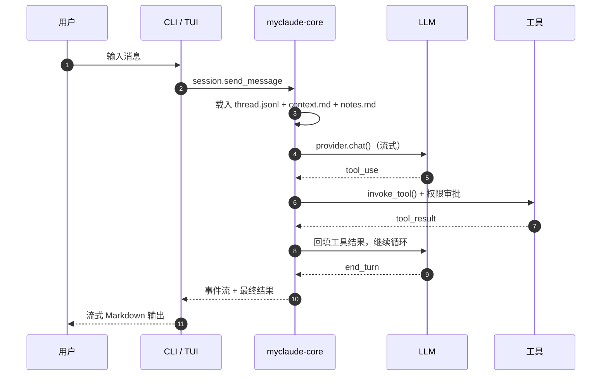

<div align="center">


</div>

# myclaude

<p align="center">
  <strong>本地守护进程架构的 AI 编程 Agent</strong><br>
  <sub>一个长期运行的 core 守护进程，CLI 与 TUI 两个瘦客户端</sub>
</p>

<p align="center">
  
  
  
  
  
  
</p>

myclaude 是一个用 Python 3.12 编写的本地 AI 编程 Agent。会话、LLM 流式调用、工具执行、权限审批、技能、子代理、上下文压缩与追踪都集中在一个 TCP 守护进程（`myclaude-core`）里；`myclaude`（CLI）和 `myclaude-tui`（Textual）只负责输入输出，通过行分隔的 JSON-RPC 2.0 与守护进程通信。

Agent 采用 ReAct 循环：模型返回 `tool_use` 就执行工具并回填 `tool_result`，直到 `end_turn` 或达到步数上限。模型侧基于 Anthropic SDK，可指向任何 Anthropic 兼容端点。

> 🐾 **一句话**：一个常驻本地、会调工具、会记笔记、还能派子代理干活的 AI 编程搭子。

> **当前版本 `0.1.0`，处于早期开发阶段。** 功能与接口可能随时调整，请留意版本变更。

---

## ✨ 特性

**🚀 运行形态**

- 单一守护进程持有全部状态，可同时服务多个 CLI / TUI 客户端。
- 三种入口：`myclaude`（CLI）、`myclaude-core`（守护进程）、`myclaude-tui`（终端 UI）。
- 事件通过 IPC 实时推送给订阅者；每次 run 的事件另存为 JSONL。

**🧰 Agent 能力**

- ReAct 工具循环，支持步数上限（默认 20）。
- 内置工具：`read_file`、`write_file`、`list_dir`、`bash`、任务管理（`task_create/update/list/get`）、会话笔记 `note_save`。
- 权限网关：`allow` / `deny` / `ask` 三态，支持单次与永久决策，永久决策持久化到 `~/.myclaude/policy.toml`。
- Markdown 技能：`/name args` 触发，支持 `allowed_tools` 白名单与 `$ARGUMENTS` 替换；内置 `init`、`orchestrate`、`review`、`summarize`。
- 子代理：`spawn_agent` / `agent_result`，支持同步与后台执行，嵌套深度上限 2；内置 planner / executor / reviewer 角色。
- 任务清单：JSON 持久化，支持状态与 `blocked_by` 依赖。
- MCP 工具接入：stdio / TCP 传输，`initialize`、`tools/list`、`tools/call`（实验特性，当前配置入口尚不可用）。

**🧠 上下文与记忆**

- 启动每次 run 时注入 `~/.myclaude/context.md`（全局）与 `./.myclaude/context.md`（项目）。
- 会话笔记 `notes.md` 注入为 Session Notes，跨轮次保留。
- 工具结果按字符预算截断；支持自动压缩（按上下文水位）与手动 `/compact [focus]`，压缩为固定六段式交接摘要。

**🔍 可观测性**

- NDJSON 全链路追踪：IPC 命令与推送、总线事件、LLM 请求/响应与耗时，默认写入 `~/.myclaude/traces/daemon.jsonl`。
- `myclaude trace` 按 run / layer / direction 过滤，支持 `--follow` 实时跟随。
- TUI 展示流式 Markdown、可展开的工具卡片、子代理缩进输出、token 用量与上下文水位条。

---

## 🏗️ 架构

```
┌──────────────┐                          ┌─────────────────────────────────────────┐
│ myclaude-tui │                          │              myclaude-core              │
│  (Textual)   │◀──────┐                 │  TCP JSON-RPC 2.0 · 127.0.0.1:7437      │
├──────────────┤       │                 │                                         │
│   myclaude   │◀──────┴────────────────▶│  SessionManager                         │
│    (CLI)     │  行分隔 JSON-RPC 2.0     │    └─ AgentRunner → AgentLoop            │
└──────────────┘                          │         ├─ LLMProvider（流式）           │
                                          │         ├─ ToolRegistry                  │
                                          │         ├─ PermissionManager             │
                                          │         ├─ Compactor                     │
                                          │         └─ Subagent（spawn_agent）       │
                                          │  EventBus → events.jsonl / IPC / Trace   │
                                          └─────────────────────────────────────────┘
```

**一次会话消息的完整路径：**

1. 客户端发送 `session.send_message`（或一次性 `agent.run`）。
2. `SessionManager` 校验会话、解析 `/skill` 前缀并生成工具白名单，把用户消息写入 `thread.jsonl`，创建 `AgentRunner`。
3. `AgentRunner` 读取历史与 `context.md` / `notes.md` 构造 `ExecutionContext`，装配工具注册表、事件写入器与追踪器。
4. `AgentLoop` 循环：`provider.chat()` 流式产出 → `tool_use` → `invoke_tool()`（参数校验、权限审批、超时与重试）→ 回填 `tool_result` → 直到 `end_turn` 或 `max_steps`。
5. 事件并行分发给 `EventWriter`（`events.jsonl`）、IPC 广播器和 Trace；run 结束后仅把本轮新增消息追加回 `thread.jsonl`。

**时序图**



**守护进程 RPC 方法：**

`core.ping`、`agent.run`、`event.subscribe`、`session.create`、`session.send_message`、`session.get_history`、`session.close`、`permission.respond`、`session.compact`。

---

## 📦 环境要求与安装

- Python **3.12+**
- [uv](https://docs.astral.sh/uv/)（推荐）或 pip

```bash
git clone <repo-url> myclaude
cd myclaude
uv sync
```

依赖由 `pyproject.toml` 管理：`anthropic`、`httpx[socks]`、`pydantic`、`textual`、`python-dotenv`、`pytest`、`pytest-asyncio`。

---

## ⚡ 快速开始

### 1. 配置模型

在**项目根目录**创建 `.env`（该文件已被 `.gitignore` 忽略）：

```dotenv
ANTHROPIC_API_KEY=sk-...
ANTHROPIC_BASE_URL=https://api.deepseek.com/anthropic
MYCLAUDE_LLM_DEFAULT_MODEL=deepseek-flash
```

`ANTHROPIC_API_KEY` 是实际调用模型的必要条件；守护进程本身可以在没有 key 的情况下启动（provider 惰性创建），但 run 或 `/compact` 会失败。

`.env` 按**当前工作目录**加载，`core start` 启动的守护进程会继承该目录，因此请始终在项目根目录执行命令。

### 2. 启动并使用

```bash
# 启动后台守护进程（写入 ~/.myclaude/myclaude-core.pid）
uv run myclaude core start
uv run myclaude ping

# 一次性任务
uv run myclaude run --goal "总结这个仓库的结构"

# 多轮对话（CLI）
uv run myclaude chat

# 终端 UI
uv run myclaude-tui

# 查看追踪 / 停止守护进程
uv run myclaude trace --follow
uv run myclaude core stop
```

> `myclaude-core` 命令是**前台**守护进程，不会写 PID 文件；`myclaude core start` 才会以分离进程启动并写 PID。CLI 的 `run` / `chat` / `trace` 与 TUI 都要求守护进程已在运行。

### 三种入口

| 命令 | 进程形态 | 职责 |
|---|---|---|
| `myclaude` | 短生命周期 CLI | `ping` / `chat` / `run` / `trace` / `core start\|status\|stop` |
| `myclaude-core` | 前台守护进程（也可 `python -m myclaude.core`） | 持有会话、模型连接、工具执行、权限与追踪 |
| `myclaude-tui` | Textual 客户端（`python -m myclaude.tui`） | 流式对话界面，连接已运行的守护进程 |

---

## 🖥️ CLI 命令

| 命令 | 参数 / 选项 | 说明 |
|---|---|---|
| `myclaude --version` | — | 打印版本号 |
| `myclaude ping` | — | 通过 `core.ping` 检查守护进程，打印版本、uptime 与往返耗时 |
| `myclaude chat` | — | 交互式多轮对话；流式输出并就地处理权限审批 |
| `myclaude run` | `--goal TEXT`（必填） | 一次性 headless 运行，`run.finished` 非 success 时退出码为 1 |
| `myclaude trace` | `[RUN_ID]`、`--layer {ipc,event,llm}`、`--direction {...}`、`--raw`、`--follow/-f` | 读取并过滤 NDJSON 追踪 |
| `myclaude core start` | — | 探测端口后启动分离守护进程并写 PID |
| `myclaude core status` | — | 仅检查端口可达性，打印 `running` / `not running` |
| `myclaude core stop` | — | 读取 PID 文件并发送终止信号 |

CLI `chat` 的权限按键：`y` 允许一次、`a` 永久允许、`n` 拒绝一次、`d` 永久拒绝。审批待决期间，下一次输入会被当作决策而不是聊天消息。

---

## 💻 TUI

`myclaude-tui` 连接已运行的守护进程并创建一个 chat 会话。

| 输入 | 行为 |
|---|---|
| `Enter` | 发送消息（斜杠命令补全打开时则选中当前项） |
| `Shift+Enter` / `Alt+Enter` / `Ctrl+J` / `Cmd+Enter` | 换行 |
| `Ctrl+Q` | 退出（尽力先关闭会话） |
| `Up` / `Down` | 导航斜杠补全或权限选项 |
| `Tab` / `Esc` | 选中补全项 / 关闭补全弹窗 |
| `y` 或 `1` | 权限：允许一次 |
| `a` 或 `2` | 权限：永久允许 |
| `n` 或 `3` | 权限：拒绝一次 |
| `d` 或 `4` | 权限：永久拒绝 |
| 点击已完成的工具卡片 | 展开 / 收起参数、输出与耗时 |

- 输入 `/` 会列出 `compact` 与所有已加载技能。
- `/compact [focus]` 在客户端侧调用 `session.compact`。
- `myclaude-tui --replay RUN_ID` 会先回放指定 run 的事件，再创建新会话。
- 断线后每 2 秒自动重连；重连会创建**新会话**，不会恢复旧对话。

---

## ⚙️ 配置

### 加载优先级

```
默认值 → TOML → .env → 进程环境变量
```

- 设置 `MYCLAUDE_CONFIG` 时只加载该文件。
- 否则依次加载 `~/.myclaude/config.toml`，再加载 `./.myclaude/config.toml`（项目配置覆盖全局）。
- 仓库根目录的 `config.toml` **不会自动加载**；需要时设置 `MYCLAUDE_CONFIG=config.toml`，或复制到 `~/.myclaude/config.toml`。
- 未知的顶层键或已知表内的未知键会直接报错退出。

### TOML 参考（含默认值）

```toml
[core]
host = "127.0.0.1"
port = 7437

[logging]
level = "INFO"
file = "~/.myclaude/logs/core.log"   # 空字符串表示关闭文件日志
format = "text"                       # text | json

[agent]
max_steps = 20

[llm]
default_model = "deepseek-flash"

[trace]
enabled = true
file = "~/.myclaude/traces/daemon.jsonl"
include_llm_payload = true

[permission]
timeout_s = 60.0                      # 0 表示一直等待

[compaction]
auto_threshold = 0.0                  # 0 关闭自动压缩（0..1 的上下文水位）
tool_result_limit = 8000              # 字符
tool_result_keep = 4000               # 字符，必须小于 limit
```

### 环境变量

| 变量 | 作用 |
|---|---|
| `MYCLAUDE_CONFIG` | 指定唯一的配置文件路径 |
| `MYCLAUDE_HOST` / `MYCLAUDE_PORT` | 守护进程监听地址（默认 `127.0.0.1:7437`） |
| `MYCLAUDE_LOG_LEVEL` | 日志级别，默认 `INFO` |
| `MYCLAUDE_LOG_FILE` | 日志文件路径，空字符串关闭文件日志 |
| `MYCLAUDE_LOG_FORMAT` | `text` 或 `json` |
| `MYCLAUDE_MAX_STEPS` | Agent 步数上限 |
| `MYCLAUDE_LLM_DEFAULT_MODEL` | 默认模型名 |
| `MYCLAUDE_TRACE_ENABLED` | 是否开启追踪 |
| `MYCLAUDE_TRACE_FILE` | 追踪文件路径 |
| `MYCLAUDE_TRACE_INCLUDE_LLM_PAYLOAD` | 是否记录完整 LLM 载荷 |
| `MYCLAUDE_PERMISSION_TIMEOUT_S` | 审批超时秒数，`0` 表示无限等待 |
| `MYCLAUDE_COMPACT_THRESHOLD` | 自动压缩阈值（0..1） |
| `MYCLAUDE_COMPACT_TOOL_LIMIT` / `MYCLAUDE_COMPACT_TOOL_KEEP` | 工具结果截断预算 |
| `MYCLAUDE_TUI_LOG_FILE` | TUI 日志路径 |
| `ANTHROPIC_API_KEY` | Anthropic（兼容）API 密钥 |
| `ANTHROPIC_BASE_URL` | Anthropic SDK 读取的兼容端点地址 |

布尔型环境变量接受 `1/true/yes/on` 与 `0/false/no/off`。

---

## 🔐 权限模型

| 工具 | 默认策略 |
|---|---|
| `read_file`、`list_dir`、`note_save` | `allow` |
| `bash`、`write_file` | `ask` |
| 其他未登记工具（含任务工具、`spawn_agent`、MCP 工具） | `ask` |

- 决策：`allow_once`、`always_allow`、`deny_once`、`always_deny`。
- 「永久」决策写入 `~/.myclaude/policy.toml` 的 `[always]` 表，下次启动继续生效。
- `bash` 额外做目录外启发式检测（绝对路径、`~`、`..`、`$HOME`、盘符路径等）；命中即强制 `ask`，即使配置了允许规则。
- 审批默认等待 60 秒，超时按拒绝处理；客户端断开不会取消挂起的审批。

---

## 🗂️ 数据目录

| 路径 | 用途 |
|---|---|
| `~/.myclaude/config.toml` | 全局配置 |
| `./.myclaude/config.toml` | 项目配置（覆盖全局） |
| `~/.myclaude/logs/core.log` | 守护进程日志（10 MB × 5 轮转） |
| `~/.myclaude/logs/tui.log` | TUI 日志（5 MB × 3 轮转） |
| `~/.myclaude/traces/daemon.jsonl` | 默认追踪文件 |
| `~/.myclaude/myclaude-core.pid` | `core stop` 使用的 PID 文件 |
| `~/.myclaude/policy.toml` | 持久化权限决策 |
| `~/.myclaude/sessions/<session-id>/` | `meta.json`、`thread.jsonl`、`notes.md`、`runs/` |
| `~/.myclaude/agents/<name>.toml` | 全局 Agent 角色配置 |
| `./.myclaude/agents/<name>.toml` | 项目 Agent 角色配置 |
| `~/.myclaude/skills`、`./.myclaude/skills` | 全局 / 项目技能 |
| `~/.myclaude/context.md`、`./.myclaude/context.md` | 全局 / 项目上下文 |

每次 run 的产物：`runs/<run-id>/events.jsonl`、`runs/<run-id>/.tasks/task_N.json`，以及压缩摘要 `summary_<ts>.md`。

---

## 📁 项目结构

```
src/myclaude/
├── cli/              # CLI 客户端：main + commands/{ping,chat,run,trace,core}
├── core/
│   ├── app.py        # 守护进程入口：RPC 注册、总线、生命周期
│   ├── runner.py     # 单次 run 编排：上下文、工具注册表、事件、持久化
│   ├── loop.py       # ReAct 循环：LLM ↔ 工具
│   ├── config.py     # 默认值 / TOML / .env / 环境变量
│   ├── context.py    # 消息上下文与 system prompt 组装
│   ├── agents/       # Agent 角色加载（planner / executor / reviewer）
│   ├── bus/          # 命令与事件模型、JSON-RPC envelope
│   ├── compact/      # 工具结果截断 + 六段式摘要压缩
│   ├── events/       # 内部事件总线与 events.jsonl 写入
│   ├── llm/          # AnthropicProvider（流式）与用量统计
│   ├── mcp/          # MCP 客户端与工具适配（实验）
│   ├── memory/       # context.md 读取
│   ├── permissions/  # 策略、审批、policy.toml
│   ├── session/      # 会话管理，thread / notes / meta 存储
│   ├── skills/       # SKILL.md 加载与内置技能
│   ├── subagent/     # spawn_agent / agent_result 与后台任务注册表
│   ├── task/         # JSON 任务清单
│   ├── tools/        # BaseTool、注册表、调用与内置工具
│   ├── trace/        # NDJSON 追踪
│   └── transport/    # TCP JSON-RPC 服务端 / 客户端、事件广播
└── tui/              # Textual 客户端
```

---

## 🧪 测试

```bash
uv run pytest
uv run pytest tests/unit -q
uv run python scripts/s1_selftest.py
```

- `tests/unit` 覆盖传输层、IPC 广播、任务管理、内置工具、追踪、stdout 渲染与 TUI 渲染，共 11 个文件。
- 双进程测试会真正启动一个 `python -m myclaude.core` 子进程（随机端口、日志重定向到 `daemon-test.log`）。
- `scripts/s1_selftest.py` 使用 FakeProvider，不需要 API key，验证工具调用链与事件顺序。

---

## 📄 License

仓库目前暂未包含 `LICENSE` 文件，发布或分发前请先补充许可证。
